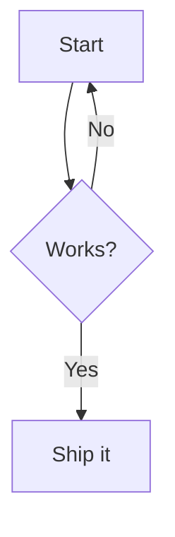

Everything about your seite site is configured in a single `seite.toml` file. The static site generator uses sensible defaults, so most sections are optional: start with `[site]` and `[[collections]]`, then add sections as you need them.

## Overview

All configuration lives in `seite.toml` at the project root, created by [`seite init`](/docs/getting-started). Here's a complete example:

```toml
[site]
title = "My Site"
description = "A personal blog and documentation"
base_url = "https://example.com"
language = "en"
author = "Jane Doe"

[[collections]]
name = "posts"
paginate = 10

[[collections]]
name = "docs"

[[collections]]
name = "pages"

[build]
output_dir = "dist"
minify = true
fingerprint = true

[deploy]
target = "github-pages"

[languages.es]
title = "Mi Sitio"
description = "Un blog personal"

[images]
widths = [480, 800, 1200]
quality = 80
webp = true
avif = false
lazy_loading = true

[analytics]
provider = "google"
id = "G-XXXXXXXXXX"
cookie_consent = true
```

## [site]

| Field | Type | Default | Description |
|-------|------|---------|-------------|
| `title` | string | required | Site title, used in templates and meta tags |
| `description` | string | `""` | Site description for SEO |
| `base_url` | string | `"http://localhost:3000"` | Full base URL for canonical links, sitemap, RSS |
| `language` | string | `"en"` | Default language code |
| `author` | string | `""` | Author name for JSON-LD and RSS |
| `timezone` | string | local time | Time zone that decides "today" for scheduled publishing and for dating new files: an IANA name (`"Europe/Berlin"`) or a fixed offset (`"+02:00"`, `"UTC"`). Unset: the machine's local date (CI runners use UTC, so set it when the cron build must agree with your local date). `seite init` writes the detected system zone; `seite upgrade` never adds it (it recommends it once when `schedule = true`), and `seite context` reports `TIMEZONE_UNSET` |

{}
Set `base_url` to your real domain before deploying. Leaving it as `localhost` will trigger a pre-flight warning and produce incorrect canonical URLs, sitemaps, and RSS feeds.
{}

## [[collections]]

Each `[[collections]]` entry defines a content collection. See [Collections](/docs/collections) for full details.

```toml
[[collections]]
name = "posts"
label = "Blog"
directory = "posts"
url_prefix = "/posts"
default_template = "post.html"
has_date = true
has_rss = true
listed = true
private = false             # optional: exclude from discovery; password-protect with [access]
access_group = "members"    # optional: password group (defaults to collection name)
nested = false
paginate = 10
subdomain = "blog"          # optional: deploy to blog.example.com
subdomain_base_url = "https://blog.example.com"  # optional: explicit URL override
deploy_project = "my-blog"  # optional: Cloudflare/Netlify project for subdomain
```

When `subdomain` is set on a collection, it gets its own output directory (`dist-subdomains/{name}/`), its own base URL (`https://{subdomain}.{base_domain}`), and its own sitemap, RSS, robots.txt, llms.txt, and search index. The collection is excluded from the main site build. The subdomain **root page** renders with the collection's own index template (e.g. `trust-index.html`) and context — exactly like that collection's index page on the main domain. Use `subdomain_base_url` to override the auto-derived URL (useful when `base_url` contains `www`). See [Collections](/docs/collections) for details.

### Frontmatter schemas

A collection can declare typed frontmatter fields. `seite build` and `seite check` then validate every page of the collection and report each violation as a `frontmatter-schema` error at the exact `file:line`, with the field's `description` as the hint. `seite new` and the MCP create tool write defaults from the schema.

```toml
[[collections]]
name = "posts"
# ...
strict_fields = true            # optional: warn about keys the schema does not declare

[collections.fields.description]
type = "string"
required = true
max = 160
description = "Summary for search results and social cards"

[collections.fields.author]
type = "string"
default = "Jane Doe"

[collections.fields.status]
type = "enum"
enum = ["draft", "review", "published"]

[collections.fields.rating]
type = "integer"
min = 1
max = 5
```

| Key | Description |
|-----|-------------|
| `type` | `string`, `text`, `number`, `integer`, `bool`, `date` (YYYY-MM-DD), `datetime` (YYYY-MM-DDTHH:MM:SS, optional offset), `url` (http(s) URL or a path starting with `/`), `image` (path or URL), `enum`, `list`, `object` |
| `required` | The field must be present and non-empty |
| `enum` / `values` | Allowed values of an `enum`, or of each item of a `list` with `items = "enum"` |
| `items` | Type of each `list` element (a scalar type) |
| `min` / `max` | Bounds of a number, or the length of a string (characters) or list (items) |
| `pattern` | Regular expression a string (or each string item) must contain; unanchored — write `^…$` to match the whole value |
| `default` | Written by `seite new` and MCP `seite_create_content` when the field is not given; never injected at build time |
| `description` | What the field is for; shown in errors, `seite templates` and `seite context` |

**Where fields live.** Fields named like built-in keys (`title`, `date`, `description`, `image`, `tags`, `draft`, `slug`, `template`, `robots`, `weight`, `updated`, `aliases`, `expires`, `series`, `series_order`) and `[[taxonomies]]` names (such as `categories`) are validated at the top level, so a schema can tighten them (for example `description` required with `max = 160`). Every other field is a custom field: write it at the top level (`author: Jane`) or under `extra:` (`extra:` / `  author: Jane`), not both — it is validated wherever it appears, and a field in both places is a `frontmatter-schema` error naming both lines. Templates read either spelling as `{{ page.extra.author }}`, and published `.md` copies include declared custom fields where they were written (undeclared top-level keys stay out of them).

**Required fields in new files.** `seite new` writes each default; a required field without a default is written empty (`''`, `[]`, `false` or `null`) and listed as "fill in", and `seite check` points at it until it has a value. MCP `seite_create_content` refuses (writes nothing) when a value it was given breaks the schema or a required field it could have passed is missing; `seite_update_frontmatter` (and `seite frontmatter set`) refuses changes that break the schema; a custom field already in the file is edited where it is, and a new one (`author`, or `extra.author`) is stored under `extra:`.

Drafts are validated with `--drafts` (and always by `seite check --file` and the after-edit hook). Scheduled (future-dated) pages are always validated. `seite init` writes small presets (types and descriptions only: no length bounds); nothing is required unless you add `required = true`, and `seite upgrade` never adds schemas to existing sites.

### Private collections

Set `private = true` to keep a collection **out of every public discovery surface** while still building its hub and pages. Add `[access]` to enforce password authentication on Cloudflare Pages.

```toml
[[collections]]
name = "docs"
private = true
access_group = "staff"
url_prefix = "/docs"
default_template = "doc.html"
```

When `private = true`:

- **The collection builds fully** — every item page *and* its auto-generated hub/index page render (with the collection's index template and `data.*` context), for the default language and every `/{lang}/` variant. Unlike `listed = false`, the hub is **not** suppressed.
- **Its pages are excluded** from the homepage listing, `sitemap.xml`, `llms.txt`, `llms-full.txt`, `search-index.json`, RSS/Atom feeds, and tag pages.
- **Every page is stamped** `<meta name="robots" content="noindex, nofollow">` unless it sets its own `robots` frontmatter.
- **Internal links still resolve** and the `.md` alternates keep generating (they live under the gated path).

`private` is independent of `listed` (the hub renders even when the collection is hidden from the homepage) and composes with `subdomain`, `paginate`, and the rest. The build logs how many pages were excluded, e.g. `12 private pages excluded from discovery`. Absent or `false`, behavior is unchanged.

Without `[access]`, `private` remains a discovery-only setting and does not restrict who can load a URL. This preserves existing configurations.

## [access]

Enable password protection for all `private = true` collections:

```toml
[access]
mode = "password"
session_hours = 168
```

| Field | Type | Default | Description |
|-------|------|---------|-------------|
| `mode` | string | required | Access mode; currently `"password"` |
| `session_hours` | integer | `168` | How long an authenticated browser session remains valid (1–8760) |

Password access currently supports **Cloudflare Pages only**. During `seite build`, seite generates an advanced-mode `_worker.js` that checks the password before serving protected files. Missing secrets fail closed with a service-unavailable response.

The protected scope comes from the collection:

- A non-empty `url_prefix` protects that path and its descendants.
- Translated versions of that collection are protected under each configured language prefix.
- An empty prefix protects the entire main domain.
- A private collection with `subdomain` protects the entire subdomain output.
- When scopes overlap, the most-specific path wins.

Each private collection's password group defaults to its `name`. Set `access_group` to let multiple collections share one password or to give different paths different passwords. Group names may contain ASCII letters, numbers, `_`, and `-`.

```bash
seite access groups
seite access set-password staff
seite deploy
```

The command prompts for the password, then stages it and separate signing secrets for both production and preview on each relevant Cloudflare Pages project through Wrangler. Secrets are not stored in the config, source tree, logs, or command arguments. Deploy from the Pages project's configured production branch to activate production; projects created by seite use `main`. Run `seite deploy --preview` to activate preview.

Ordinary `static/` files stay public. With `[access]` enabled, place protected downloads under `static/private/<group>/`; they are emitted at `/private-assets/<group>/` and gated by that group. Image optimization is skipped for this protected tree so derivatives cannot escape into public `/static`, and the legacy `/static/private/` URL namespace is denied. Without `[access]`, those files remain under `/static/private/<group>/` and are publicly reachable.

Password access owns the generated Cloudflare `_worker.js` and `_routes.json`. Remove custom versions from `public/` before enabling it; a conflicting file fails the build rather than risking an authentication bypass.

## [build]

| Field | Type | Default | Description |
|-------|------|---------|-------------|
| `output_dir` | string | `"dist"` | Build output directory |
| `data_dir` | string | `"data"` | Directory for data files (YAML/JSON/TOML) |
| `public_dir` | string | `"public"` | Directory for root-level files copied to output without prefix (favicon.ico, .well-known/, _redirects, etc.) |
| `minify` | bool | `false` | Strip CSS/JS comments and collapse whitespace |
| `fingerprint` | bool | `false` | Add content hash to asset filenames for cache busting |
| `math` | bool | `false` | Enable math/LaTeX rendering (`$inline$` and `$$display$$` blocks via KaTeX) |
| `mermaid` | bool | `false` | Render fenced ` ```mermaid ` blocks as [Mermaid](https://mermaid.js.org/) diagrams (client-side) |
| `related` | int | `3` | Maximum `page.related` entries per page; `0` disables related pages. A collection's own `related` overrides it |
| `schedule` | bool | `false` | Scheduled publishing for dated collections: hide posts dated in the future until their date, and `expires:` posts after it. `seite init` sets it for new sites; existing sites build as before until you add it |
| `future` | bool | `false` | With `schedule`: build future-dated content too. `seite build --future` does the same for one build; `seite serve` always previews it |
| `search` | `"full"` \| `"basic"` \| `false` | `"basic"` | Client-side search. `"full"`: full-text index of page text under `search/` (see [Search](#search)); `"basic"`: `search-index.json` only (titles, descriptions, tags); `false`: no index and no search box. `seite init` writes `"full"`; existing sites keep `"basic"` until they add it |

{}
Enable `minify` for production builds. It strips CSS/JS comments and collapses whitespace for smaller files. Enable `fingerprint` when your CDN caches aggressively: content hashes in filenames ensure browsers always fetch the latest version.
{}

When `fingerprint = true`, static files get hashed names (e.g., `style.a1b2c3d4.css`) and an `asset-manifest.json` is written to the output directory.

### Search

Every bundled theme has a search box. What it searches depends on `search`:

```toml
[build]
search = "full"   # or "basic", or false
```

- **`"full"`** (new sites): the build writes a full-text index next to the pages, so search works on any static host with no service or API key. It indexes the text of each page (the rendered content, not the theme's navigation or footer) plus its title, headings, tags and description. The browser downloads only what a query needs: a small `search/meta.json` on first focus, then the index shard that holds each search term and one small file per result shown. On a 1,000-page site a typical query downloads well under 100 KB.
- **`"basic"`** (the default when the key is absent, so existing sites build exactly as before): only `search-index.json`, matching titles, descriptions and tags.
- **`false`**: no index and no search box.

Results are ranked by where the words occur (title, then headings, then tags and description, then body text). All words must match; the last word also matches as a prefix while you type ("deplo" finds "deploy", and on English sites "buildin" finds "building"). A last word that matches nothing yet (or is a word like "the") does not empty the results of the words before it. Matching ignores case and accents ("cafe" finds "Café"). English sites (`language = "en"`, or an `en` translation) also match word forms ("posts" finds "post", "running" finds "run") and skip words like "the" and "of"; other languages match whole words. Chinese, Japanese and Korean text is matched by pairs of characters. Each result shows a snippet with the matching words highlighted. Use the arrow keys to move through results, Enter to open one, Escape to close them.

Drafts, scheduled posts, pages with `robots: noindex`, unlisted collections and private collections are never indexed. Multilingual sites get one index per language (`search/` for the default language, `<lang>/search/` for the others), and the search box on a page searches that page's language.

Index layout (for custom scripts; `search-index.json` keeps its format in every mode):

| File | Contents |
|------|----------|
| `search/meta.json` | Format version, language, whether English stemming is on, page count, a content hash (`hash`, added to the other URLs as `?v=`), collection names, each page's collection, and the first term of each shard |
| `search/terms/<n>.json` | `{"term": [page id delta, weight, …]}` for a sorted range of terms, about 8 KB per file |
| `search/pages/<id>.json` | One page: title, URL, collection, date, description and the first 3,000 characters of its text |

`seite build --verbose` prints the index size, and `seite build --json` reports it as `data.search_index` (`pages`, `terms`, `files`, `bytes`, `shards`, `largest_shard_bytes`, `meta_bytes`, `largest_page_bytes`). To limit a search box to some collections, put `` right before its include; see [Templates](/docs/templates#search) for the markup and result styling.

### Mermaid diagrams

Set `mermaid = true` under `[build]` to render [Mermaid](https://mermaid.js.org/) diagrams from ordinary fenced code blocks — no shortcode required:

````markdown

````

Each ` ```mermaid ` block is emitted as `<div class="mermaid">…</div>`, and a small Mermaid loader (from a CDN) is injected **only on pages that contain a diagram** — pages without one pay nothing. Diagrams render in the browser, so they work with any theme.

When `mermaid = false` (the default), a ` ```mermaid ` block is treated like any other unrecognized language and rendered as a plain code block.

### CSS processing

seite does not include a Sass/SCSS/PostCSS preprocessor. This is a deliberate design choice: all theme CSS lives inline in the Tera template file, making themes completely self-contained single files with no external dependencies. This means:

- No build toolchain beyond the `seite` binary itself
- Themes are portable: install from a URL, no asset pipeline setup
- AI-generated themes (`seite theme create`) produce one complete file

Modern CSS natively supports features that previously required preprocessors: custom properties (variables), nesting, `calc()`, `color-mix()`, `clamp()`. For projects that need Sass, compile externally (`sass style.scss static/style.css`) and reference the output in your template: seite copies everything in `static/` to the output directory.

See [Building Custom Themes](/docs/custom-themes#css) for more detail on this approach.

## Data Files

Place YAML, JSON, or TOML files in the `data/` directory to make structured data available in all templates as `{{ data.filename }}`.

### Supported formats

| Extension | Format |
|-----------|--------|
| `.yaml`, `.yml` | YAML |
| `.json` | JSON |
| `.toml` | TOML |

### Nested directories

Subdirectories create nested keys:

```
data/
  nav.yaml          → {{ data.nav }}
  authors.json      → {{ data.authors }}
  menus/
    main.yaml       → {{ data.menus.main }}
    footer.yaml     → {{ data.menus.footer }}
```

### Theme integration

All bundled themes conditionally render `data.nav` for header navigation and `data.footer` for footer links and copyright. Example `data/nav.yaml`:

```yaml
- title: Blog
  url: /posts
- title: About
  url: /about
- title: Docs
  url: /docs
```

Example `data/footer.yaml`:

```yaml
links:
  - title: GitHub
    url: https://github.com/user/repo
  - title: Twitter
    url: https://twitter.com/user
copyright: "2026 My Company"
```

### Conflict detection

The build will error if two data files share the same stem (e.g., `authors.yaml` and `authors.json`) or if a file and directory conflict (e.g., `nav.yaml` and `nav/main.yaml`). Unknown file extensions are skipped with a warning.

### Per-language values

On a multi-language site, any data value may be a **language map** — a mapping keyed by your configured language codes — and it resolves to the page's language at build time:

```yaml
purpose:
  en: "Cloud infrastructure"
  de: "Cloud-Infrastruktur"
```

Plain values are unchanged; only maps whose keys are *all* configured language codes are resolved. See [Per-Language Data Values](/docs/i18n#per-language-data-values).

## [[taxonomies]]

Group content by terms beyond tags, for example categories. Each entry adds a term index, a page per term and, by default, per-term RSS and Atom feeds, in every language:

```toml
[[taxonomies]]
name = "categories"      # frontmatter key: categories: [rust, web]
# label = "Categories"   # display name (default: t.categories, else the title-cased name)
# url_prefix = "/topics" # default "/<name>"
# feed = true            # per-term feed.xml + atom.xml (default true)
# paginate = 10          # items per term page (default: one page per term)
# template = "taxonomy.html"     # term index template
# term_template = "term.html"    # term page template
```

| Field | Type | Default | Description |
|-------|------|---------|-------------|
| `name` | string | required | Taxonomy name and frontmatter key |
| `label` | string | `t.<name>` or title-cased name | Display name |
| `url_prefix` | string | `/<name>` | URL prefix of the index and term pages |
| `feed` | bool | `true` | Write `<term>/feed.xml` and `<term>/atom.xml` (items of collections with `has_rss`) and link them from the term page |
| `paginate` | int | none | Items per term page; later pages are at `<term>/page/N/` |
| `template` | string | `taxonomy.html` | Template of the term index |
| `term_template` | string | `term.html` | Template of each term page |

Output for `name = "categories"`: `/categories/` (all terms with counts), `/categories/<slug>/` (pages with that term, newest first), `/categories/<slug>/feed.xml` and `atom.xml`, and the same under `/es/categories/...` for each extra language. All of them are in the sitemap. Terms group case-insensitively by slug (`Web Dev` and `web dev` are one term); the most common spelling is displayed.

Each taxonomy needs its own URL prefix: one that equals a collection's `url_prefix`, another taxonomy's (including `/tags`), `/series`, or a language code stops the build with [`taxonomy-url-collision`](/docs/errors#taxonomy-url-collision). Don't name a taxonomy after a built-in frontmatter field (`extra`, `series`, `draft`, …): [`taxonomy-reserved-name`](/docs/errors#taxonomy-reserved-name).

`tags` needs no entry: `/tags/` and `/tags/<slug>/` are always generated, with no per-tag feeds. Add `[[taxonomies]] name = "tags"` to give tags the same options, for example per-tag feeds (on by default once configured) or pagination; tags keep their `tags.html`/`tag.html` templates and URLs.

Taxonomies and related pages also weigh into `page.related` (see [Related pages](/docs/collections#related-pages)).

## [deploy]

| Field | Type | Default | Description |
|-------|------|---------|-------------|
| `target` | string | `"github-pages"` | Deploy target: `github-pages`, `cloudflare`, `netlify` |
| `repo` | string | auto-detected | Git repository URL (GitHub Pages) |
| `project` | string | auto-detected | Project name (Cloudflare Pages) |
| `auto_commit` | bool | `true` | Auto-commit and push before deploying. On non-main branches, auto-uses preview mode |
| `markdown_negotiation` | bool | `false` | Cloudflare Pages only: generate a `_worker.js` that serves a page's markdown copy to requests with `Accept: text/markdown`. Every page request then counts as a Functions request (Workers Free: 100,000 a day). Sites with `[access]` get it without this switch. See [Markdown for agents](/docs/deployment#markdown-for-agents) |

## [languages.*]

Optional. Add language sections to enable multi-language support:

```toml
[languages.es]
title = "Mi Sitio"
description = "Un blog personal y documentaci&oacute;n"

[languages.fr]
title = "Mon Site"
```

Each language can override `title` and `description`. See [Multi-language](/docs/i18n) for details.

## [images]

Optional. When this section is present, `seite` automatically processes images in `static/`. When omitted, images are copied as-is with no resizing or rewriting. New projects created with `seite init` include this section by default.

| Field | Type | Default | Description |
|-------|------|---------|-------------|
| `widths` | array | `[480, 800, 1200]` | Target widths in pixels for resized copies |
| `quality` | int | `80` | JPEG/WebP quality (1-100) |
| `webp` | bool | `true` | Generate WebP variants alongside originals |
| `avif` | bool | `false` | Generate AVIF variants alongside originals (better compression than WebP) |
| `avif_quality` | int | `70` | AVIF quality (1-100). Lower than WebP is fine — AVIF compresses better |
| `lazy_loading` | bool | `true` | Add `loading="lazy"` to `` tags |

When configured, images in `static/` are resized to each width, optionally converted to WebP and/or AVIF, and `` tags in HTML are rewritten with `srcset` and `<picture>` elements. AVIF sources appear first in the `<picture>` element so browsers that support AVIF use it (best compression), falling back to WebP, then the original format. To disable image processing, remove the `[images]` section entirely.

## [analytics]

Optional. When present, analytics scripts are automatically injected into every HTML page during build. Supports Google Analytics 4, Google Tag Manager, Plausible, Fathom, and Umami.

| Field | Type | Default | Description |
|-------|------|---------|-------------|
| `provider` | string | required | Analytics provider: `google`, `gtm`, `plausible`, `fathom`, `umami` |
| `id` | string | required | Measurement/tracking ID (e.g., `G-XXXXXXX`, `GTM-XXXXX`, domain, or site ID) |
| `cookie_consent` | bool | `false` | Show a cookie consent banner and gate analytics on user acceptance |
| `script_url` | string | varies | Custom script URL (required for self-hosted Umami, optional for others) |
| `extensions` | array | `[]` | Plausible script extensions (e.g., `["tagged-events", "outbound-links"]`). Ignored for other providers and when `script_url` is set |

### Examples

**Google Analytics 4 (direct):**

```toml
[analytics]
provider = "google"
id = "G-XXXXXXXXXX"
```

**Google Analytics 4 with cookie consent banner:**

```toml
[analytics]
provider = "google"
id = "G-XXXXXXXXXX"
cookie_consent = true
```

**Google Tag Manager:**

```toml
[analytics]
provider = "gtm"
id = "GTM-XXXXXXX"
cookie_consent = true
```

**Plausible Analytics (privacy-friendly, no cookies):**

```toml
[analytics]
provider = "plausible"
id = "example.com"
```

For new installations, Plausible now provides a **unique snippet per site** from your dashboard (Settings → Installation). Use `script_url` to point to it — features like tagged events, outbound links, and file downloads are toggled in your Plausible site settings and automatically included. seite generates the correct `async` script tag plus the `plausible.init()` bootstrapper for custom event support:

```toml
[analytics]
provider = "plausible"
id = "example.com"
script_url = "https://plausible.io/js/pa-XXXXXXXXXX.js"
```

**Legacy: Plausible with extensions (pre-October 2025 script)**

The old extension-based approach still works for existing setups but won't receive new Plausible features:

```toml
[analytics]
provider = "plausible"
id = "example.com"
extensions = ["tagged-events", "outbound-links", "file-downloads"]
```

The `extensions` field appends names to the script filename (e.g., `script.tagged-events.outbound-links.js`). New sites should use `script_url` with the unique snippet from the Plausible dashboard instead. See the [Plausible script update guide](https://plausible.io/docs/script-update-guide).

**Fathom Analytics:**

```toml
[analytics]
provider = "fathom"
id = "ABCDEF"
```

**Self-hosted Umami:**

```toml
[analytics]
provider = "umami"
id = "abc-def-123"
script_url = "https://stats.example.com/script.js"
```

{}
Privacy-respecting analytics like Plausible, Fathom, and Umami don't use cookies. You can typically use them without a consent banner (`cookie_consent = false`). Google Analytics and GTM set cookies and may require consent under GDPR/ePrivacy: set `cookie_consent = true` for those.
{}

### Cookie consent banner

When `cookie_consent = true`, a fixed-position banner appears at the bottom of the page on the visitor's first visit. Analytics scripts only load after the visitor clicks "Accept". The choice is stored in `localStorage` so it persists across visits. The banner is fully accessible with `role="dialog"`, keyboard-navigable buttons, and responsive design.

### How it works

Analytics injection happens as a post-processing step after the main build. Every `.html` file in the output directory is rewritten:

- **Without consent:** the analytics `<script>` tag is injected before `</head>`. GTM also gets a `<noscript>` fallback after `<body>`.
- **With consent:** a consent banner with Accept/Decline buttons is injected before `</body>`. Analytics scripts are loaded dynamically only after the user accepts.

To remove analytics, delete the `[analytics]` section from `seite.toml`.

## [check]

Options for `seite check --external`, which checks external links over the network (never run by default):

```toml
[check]
external_skip = ["example.com", "intranet.local"]  # hosts never requested (subdomains included)
external_timeout = 10                               # seconds per request
```

| Field | Type | Default | Description |
|-------|------|---------|-------------|
| `external_skip` | list | `[]` | Hosts never requested, in addition to the built-in list of hosts that block bots (`linkedin.com`, `twitter.com`, `x.com`, `instagram.com`, `facebook.com`) |
| `external_timeout` | integer | `10` | Seconds per request |

## [og]

### Social cards

Every page gets a social preview card: a 1200x630 PNG generated at build time (offline, free, the same bytes on every run) and set as its `og:image` and `twitter:image`. New sites have it on; for existing sites add the section:

```toml
[og]
generate = true
template = "default"          # default | minimal | bold
# background = "#ffffff"      # colors: #rgb or #rrggbb
# foreground = "#1a1a1a"
# accent = "#0057b7"
# logo = "static/logo.svg"    # SVG or PNG, drawn on every card
# font = "static/fonts/NotoSansJP-Bold.ttf"  # replaces the bundled Inter
```

| Field | Type | Default | Description |
|-------|------|---------|-------------|
| `generate` | bool | `true` | Generate cards (absent `[og]` = off) |
| `template` | string | `"default"` | Layout: `default` (accent bar, site name on top), `minimal` (title first, quiet footer), `bold` (full accent background) |
| `background` / `foreground` / `accent` | string | brand, else theme | Card colors. Default: `colors.background` / `colors.text` / `colors.primary` from `data/brand.yaml`, else the active theme's palette |
| `logo` | string | none | SVG or PNG inside the site (no symlinks), at most 1 MB and 4096 px per side; an SVG logo can embed images only as `data:` URIs |
| `font` | string | bundled Inter | A `.ttf`/`.otf`, relative to the site root, for titles in scripts Inter lacks |

**Which pages.** Each public, non-draft content page without `image:` in its frontmatter gets `og/<url>.png` (`/posts/hello-world` → `/og/posts/hello-world.png`, translations under `og/<lang>/`). Each language's homepage gets the *site card*, `og/index.png` (site name and description), which every other page uses: collection indexes, tag pages, 404, drafts and private pages. Private collections never get cards of their own: they would publish their titles. A page with `image:` keeps its image.

**What a card shows.** Site name (or host), the page title (wrapped to three lines, shrunk and finally cut with an ellipsis), and the collection, date and reading time; plus the logo.

**Fonts.** Cards use a bundled subset of [Inter](https://rsms.me/inter/) (SIL Open Font License; `seite --licenses` prints it) with Latin, Greek and Cyrillic, and never system fonts, so output does not depend on the machine. The "min read" label comes from the site's UI strings (`min_read` in `data/i18n/<lang>.yaml`); untranslated languages show just "N min". A title with characters the font lacks (Chinese, Japanese, Korean, emoji) gets no card of its own rather than empty boxes, and the build warns once (`og-missing-glyphs`); set `font` to a font that has them.

**Cache.** Cards are cached in `.seite/cache/og/` (gitignored, one directory per output, so the main site and each subdomain), keyed by everything that affects them (text, colors, layout, font and logo bytes, seite version), so rebuilds only render changed cards. Each full build deletes the entries it no longer uses. `seite serve` generates them too; a content edit re-renders only that page's card. `seite check` validates `[og]` (bad colors, missing logo or font: `og-config-invalid`) but renders nothing. Delete the cache directory any time.

**Try it.** `seite og preview /posts/hello-world` writes `.seite/cache/og-preview.png` (`--out card.png`, `--template bold` to compare layouts without editing the config; `/` is the site card).

## Frontmatter

Content files use YAML frontmatter between `---` delimiters:

```yaml
---
title: "Page Title"
date: 2026-02-18
updated: 2026-02-19
description: "Used in meta tags, OG, Twitter Cards, JSON-LD"
image: /static/preview.jpg
slug: custom-slug
tags:
  - rust
  - web
draft: true
template: custom.html
robots: noindex
extra:
  hero: true
  color: "#4361EE"
---
```

| Field | Type | Required | Description |
|-------|------|----------|-------------|
| `title` | string | Yes | Page title |
| `date` | date | Posts only | Publication date (YYYY-MM-DD) |
| `updated` | date | No | Last modified date |
| `description` | string | No | SEO description |
| `image` | string | No | Social preview image |
| `slug` | string | No | Override auto-generated slug |
| `tags` | list | No | Content tags |
| `categories` (or any `[[taxonomies]]` name) | list or string | No | Terms of that taxonomy |
| `series` | string | No | Series this page belongs to (`page.series`, `/series/<slug>/`) |
| `series_order` | int | No | Position in the series (lower first) |
| `draft` | bool | No | Exclude from build unless `--drafts` |
| `template` | string | No | Override default template |
| `robots` | string | No | Per-page robots directive |
| `expires` | date | No | Last day the page is published; later builds leave it out (dated collections, with `[build] schedule = true`) |
| `extra` | map | No | Arbitrary data for templates |

### Scheduled publishing

Scheduled publishing is on when `[build] schedule = true` (new sites get it from `seite init`; existing sites keep building every page until you add it — `seite upgrade` only tells you about it) and applies to collections with `has_date = true`:

```toml
[build]
schedule = true
```

A post whose `date` (or `YYYY-MM-DD-` filename prefix) is after today is scheduled: like a draft, it is left out of the build — HTML, `.md`, feeds, sitemap, search index, `llms.txt`/`llms-full.txt`, tag pages and listings — until the first build on or after its date. `expires: 2026-12-31` keeps a post up through that day and removes it from builds from the next day on. "Today" is the date in `[site] timezone`, or the machine's local date when it is unset — the same date `seite new` and `seite init` put on new posts, so a post written today is never hidden. `seite build --future` or `[build] future = true` includes scheduled posts, and `seite serve` always shows them; expired posts are never built.

`seite build` and `seite serve` print one line when scheduling hides posts (`2 scheduled posts hidden; next goes live 2026-11-01 (Launch)`), and so does `seite check` (an info note, not a diagnostic). `seite check` resolves links exactly like the build — a link from a published page to a hidden one is a `link-to-scheduled` warning with the go-live date (`--strict` fails on it; `seite check --future` treats scheduled posts as published) — and still renders scheduled posts, so a post that will publish on its own is validated today. `seite stats` lists future-dated and expired posts and the next scheduled one, and `seite context` prints `next scheduled: <date> (<title>)`.

Because a static site only changes when it is rebuilt, the GitHub Actions workflow `seite init` generates rebuilds daily (`schedule: - cron: '17 5 * * *'`). See [Deployment](/docs/deployment#scheduled-publishing) for each host.

## seite-workspace.toml

For multi-site setups, a `seite-workspace.toml` at the workspace root configures all sites. Each site still has its own `seite.toml`.

```toml
[workspace]
name = "my-workspace"
shared_data = "data"           # Shared data directory (optional)
shared_static = "static"       # Shared static assets (optional)
shared_templates = "templates" # Shared templates (optional)

[[sites]]
name = "blog"
path = "sites/blog"
# base_url = "https://blog.example.com"  # Override site base_url
# output_dir = "dist/blog"               # Override output location

[[sites]]
name = "docs"
path = "sites/docs"

[cross_site]
unified_sitemap = false    # Combine all sites into one sitemap
cross_site_links = false   # Validate links across sites
unified_search = false     # Combined search index
```

See [Workspaces](/docs/workspace) for the full guide.

## Next Steps

- [Collections](/docs/collections): configure how posts, docs, and pages behave
- [Templates & Themes](/docs/templates): use config values and data files in your templates
- [Deployment](/docs/deployment): deploy with the settings you've configured
- [Workspaces](/docs/workspace): manage multiple sites in a single repository
